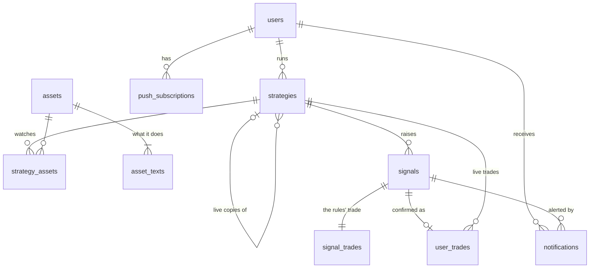

# Data model

Source: [app spec §8](../docs/strategy-trading-lab-app-spec.md#8-data-the-app-needs). Status: **reviewed, ready to build**.

## Decisions

- PostgreSQL 17 on Neon (15 is the minimum: the schema uses `NULLS NOT DISTINCT`). A `dev` branch for local work, `main` for prod.
- EF Core + Npgsql migrations, .NET 10.
- Primary keys are **UUID v7**, generated in .NET (Npgsql does this for `Guid` keys by default; no database default).
- **Templates are code, not data.** Each template (engine rules, tested defaults, starter list or fund) is defined in the backend, and its copy (name, tagline, idea, rules…) sits in a JSON file next to it. The API serves the `TemplateDetail` DTO the frontend uses now. The database only stores `template_key` on a strategy.
- **Defaults are copied into the strategy** at creation (`params`, budget, assets). After that they belong to the user and are overwritten when changed; no history. `defaults_version` records which tested defaults the strategy started from, so "[n] changed" and "Reset to tested" stay right if a template's defaults are retuned later.
- Per-template settings are **one `params jsonb` column**, validated by a typed C# record per template.
- **Assets** is the name for stocks and funds (the UI still says *stock* or *fund*). The API identifies an asset by its **id**, not its symbol: the frontend's `Security` DTO gains an `id`, and the draft's `unticked` becomes a list of asset ids.
- **Multi-currency ready.** Every amount is read in a stated currency. v1 runs in euro with US dollar prices, but nothing in the schema assumes it.
- **A day is the US market date** (`America/New_York`, trading calendar) for every `date` column: `started_on`, `signal_date`, `snoozed_until`, `for_date`, trade dates. The user's time zone only decides when emails arrive.
- **No pause.** A strategy runs until it is ended. Turning its notifications off is the quiet mode; unanswered signals become *missed* when their window closes.
- **Live signals are answered Confirm, Skip or Snooze.** There is no automatic reminder; Snooze notifies again the next day.
- **Translation-ready.** The database stores codes and facts, never display sentences: statuses, reasons and signal facts are rendered in the reader's `locale` when shown or sent. v1 ships in English and Catalan; template copy is one file per language. The only translatable database text, what an asset does, is in `asset_texts`, one row per language.
- **Accounts**: sign-up, log-in and sessions ([AUTH.md](AUTH.md)). There is no seeded user.
- **AI specifics are deferred** (the feature isn't defined yet): no AI round tables or AI columns. The AI template's settings (sources, prompt, round frequency) will live in `params` like any other.
- **This migration has the user-facing tables only.** Market data, FX rates, daily evaluations and backtest results come with the engine (see the end).

## Conventions

- Table and column names in `snake_case`, tables plural.
- **Money:** `numeric(14,2)` for amounts in the strategy's currency (budget, step, trade amount, fee). `numeric(14,4)` for asset prices, in the asset's currency. `numeric(18,6)` for shares (fractional shares).
- **Currencies:** ISO 4217 codes, `char(3)` (`EUR`, `USD`).
- **FX on a trade:** `fx_rate numeric(18,8)` = units of the asset's currency per one unit of the strategy's currency, on the trade date (USD per EUR today). It is 1 when the two currencies are the same.
- **Trade maths:** `amount` never includes the fee. `shares = amount × fx_rate ÷ price`. Cost of a buy = `amount + fee`; proceeds of a sale = `amount − fee`.
- Dates are `date` (US market date, see above). Moments are `timestamptz` (UTC).
- Status and kind fields are `text` with a `CHECK` constraint, not Postgres enums (easier to extend). C# maps them to enums through one snake_case converter (`PriceRanAway` ↔ `price_ran_away`).
- Every table has `created_at timestamptz not null default now()`; mutable tables also have `updated_at`, set by a SaveChanges interceptor.
- Deletes: strategies are never hard-deleted (they end), except when the user deletes their account: everything a user owns cascades from `users`. Manual trades are soft-deleted (`deleted_at`).
- `jsonb` columns (`params`, `facts`) map to `JsonDocument` in EF and are deserialized to the template's record by `template_key` (EF can't map a different record per template).
- Extensions: `citext` (`HasPostgresExtension("citext")`).

## Diagram

## Tables

### `assets`

Stocks, funds and indexes: names and "what it does" for lists, "+ Add a stock" search and the fund picker. Seeded with every asset a template's starter list or default fund needs, plus a few more ([template-assets.md](src/StrategyTradingLab.Api/Templates/template-assets.md)); a test fails if a template points at an asset that isn't seeded.

| Column | Type | Notes |
| --- | --- | --- |
| id | uuid PK | Not the symbol: the same symbol can exist on two exchanges |
| symbol | text, not null | Yahoo Finance symbol: `ZS`, `SU.PA`, `^NDX`. Internal; the UI shows the name |
| exchange | text, not null | MIC code, e.g. `XNAS`, `XNYS`, `ARCX` |
| name | text, not null | "Zscaler" |
| kind | text, not null | `stock` \| `fund` \| `index` (followed, not bought) |
| currency | char(3), not null | Trading currency: `USD`, `EUR`, `GBP`, `HKD`… |
| active | bool, not null, default true | Delisted assets stay for history |

Unique `(symbol, exchange)`.

### `asset_texts`

"What it does", per language. Names are proper nouns and aren't translated.

| Column | Type | Notes |
| --- | --- | --- |
| asset_id | uuid FK → assets, cascade | PK part |
| locale | text | PK part. `en` \| `ca` |
| what | text, not null | "Cloud security software" / "Software de ciberseguretat al núvol" |

Every asset has an `en` row; a missing `ca` row falls back to `en`.

### `users`

| Column | Type | Notes |
| --- | --- | --- |
| id | uuid PK | |
| email | citext, unique, not null | Case-insensitive |
| password_hash | text, null | ASP.NET Core Identity `PasswordHasher` hash. Set at sign-up; null only for a user who can't log in |
| email_verified_at | timestamptz, null | |
| time_zone | text, not null | IANA name, e.g. `Europe/Madrid`. The overview goes out early morning in it |
| locale | text, not null | `en` \| `ca` in v1 (BCP 47 tags). Picked by the user at sign-up, never guessed; editable in the account. Sets the language and formats of emails and notifications |
| currency | char(3), not null, default `EUR` | Default currency for new strategies |
| overview_email | bool, not null, default true | Daily overview on/off |
| disclaimer_accepted_at | timestamptz, null | Accepted once at sign-up |
| created_at, updated_at | timestamptz | |

AI data-sharing consent is added with the AI feature.

### `sessions` and `email_tokens`

How they are used: [AUTH.md](AUTH.md). Both cascade from `users`.

`sessions`: one row per logged-in device. `token_hash bytea` unique (the SHA-256 of the cookie's token), `created_at`, `last_used_at` (written at most once a minute), `expires_at` (30 days after last use, at most 90 after creation), `user_agent text null`. No IP address.

`email_tokens`: the single-use links. `purpose` (`verify_email` | `reset_password`, CHECK), `token_hash bytea` unique, `created_at`, `expires_at` (24 hours or 1 hour), `used_at null`.

### `push_subscriptions`

| Column | Type | Notes |
| --- | --- | --- |
| id | uuid PK | |
| user_id | uuid FK → users, cascade | |
| endpoint | text, unique, not null | Web push endpoint |
| p256dh, auth | text, not null | Web push keys |
| last_failed_at | timestamptz, null | Dropped after repeated 404/410 |
| created_at | timestamptz | |

### `strategies`

| Column | Type | Notes |
| --- | --- | --- |
| id | uuid PK | |
| user_id | uuid FK → users, cascade | |
| template_key | text, not null | `CHECK` on the five keys (`dip`, `comeback`, `bear`, `trend`, `ai`); a new template updates the check |
| defaults_version | int, not null | The template's tested-defaults version at creation |
| name | text, not null | Unique per user among running strategies, case-insensitive: unique index on `(user_id, lower(name)) WHERE status = 'running'`. Ending one frees its name |
| mode | text, not null | `simulation` \| `live`. Never changes |
| status | text, not null | `running` \| `ended` |
| started_on | date, not null | "since [date]" |
| ended_at | timestamptz, null | `CHECK ((status = 'ended') = (ended_at IS NOT NULL))` |
| notifications | bool, not null, default true | Signal notifications for this strategy, on every channel. Off = it keeps running quietly |
| currency | char(3), not null | Fixed at creation. Budget, trade amounts and results are in it |
| budget_amount | numeric(14,2), not null | The most it can invest in total. Range checked in C# (€500 – €1,000,000 in euro) |
| budget_step | numeric(14,2), null | How much each buy is. Null for all in, all out. Check ≤ budget_amount |
| budget_max_steps | int, null | Max steps per stock, 1–20. Null for all in, all out. `CHECK ((budget_step IS NULL) = (budget_max_steps IS NULL))` |
| params | jsonb, not null | Every template setting, validated per template in C#. Dip in winners: `{"minGainPct":50,"gainDays":168,"peakDays":60,"zoneStartPct":5,"zoneEndPct":15,"trendDays":200,"floorDays":50,"cooldownDays":10}` (records in `Templates/TemplateParams.cs`) |
| source_strategy_id | uuid FK → strategies, null, set null | The simulation a live strategy was copied from. A simulation can have several live copies |
| created_at, updated_at | timestamptz | |

The three `budget_*` columns map to a `Budget` value object in C#. Budget and settings can be changed while running; each change overwrites the current values.

- "[n] changed" is computed in C# from `params` vs the defaults of `defaults_version`, not stored.
- **Budget used** = cost of the buys (`amount + fee`) − cost of the shares sold, at average cost. Simulation: from `signal_trades`. Live: from non-deleted `user_trades`. A sale frees budget again. For *Ride the long trend* the next buy reinvests what the sale returned, so budget used can go over the budget after a gain.
- **Lowering the budget** below what is used is allowed: the strategy stops signalling buys, nothing is sold, and "Budget used" can read over 100%.
- **Lowering max steps** below a stock's current step is allowed: that stock gets no more buys; its steps so far stay.

### `strategy_assets`

The stocks (or the one fund) a strategy watches. For a fund template, the fund the user picked ("Change"); exactly one active fund, checked in C#.

| Column | Type | Notes |
| --- | --- | --- |
| strategy_id | uuid FK → strategies, cascade | PK part |
| asset_id | uuid FK → assets | PK part |
| active | bool, not null | Inactive = unticked: still in the list, dimmed, and gives no signals |
| added_at | timestamptz, not null | |
| removed_at | timestamptz, null | Removed = gone from the list, and gives no signals. "Your trades in it stay in the results." |

At create time every starter-list asset is inserted active, except the ones the user unticked (the frontend draft keeps those).

`CHECK (removed_at IS NULL OR NOT active)`: a removed asset is never active.

**Can this asset signal?** One definition, in one C# query the engine and the screens share: `assets.active AND strategy_assets.active AND strategy_assets.removed_at IS NULL`. The three flags are different facts: `assets.active` is the market (delisted, for everyone), `strategy_assets.active` and `removed_at` are the user's choice for this strategy.

### `signals`

Both modes. Every signal gets exactly one signal trade (the rules carry on as if the step was bought, whatever the user does).

- **Simulation:** the app acts on the signal itself, so it is created `confirmed`.
- **Live:** it starts `waiting`, and the user answers **Confirm**, **Skip** or **Snooze**. Snooze doesn't answer it: it stays `waiting` and the user is notified again the next day. It can be snoozed again until its window closes; then it is `missed`. A waiting signal can be confirmed later, with the real date.

| Column | Type | Notes |
| --- | --- | --- |
| id | uuid PK | |
| strategy_id | uuid FK → strategies, cascade | |
| asset_id | uuid FK → assets | |
| side | text, not null | `buy` \| `sell` |
| step_no | int, null | The "2" in "step 2 of 5"; null for sells |
| max_steps | int, null | The "5", as set on the signal day |
| step_amount | numeric(14,2), null | The "(€100)", as set on the signal day, in the strategy's currency |
| signal_date | date, not null | The close that met the rules |
| close_price | numeric(14,4), not null | "Close on [date]: $[XXX.XX]", in the asset's currency |
| facts | jsonb, not null | Rule facts for the signal text, e.g. `{"belowPeakPct":8,"aboveSma50":true}` |
| status | text, not null | `waiting` \| `confirmed` \| `skipped` \| `missed` |
| skip_reason | text, null | `price_ran_away` \| `didnt_trust_it` \| `no_cash` \| `other` |
| answered_at | timestamptz, null | Confirmed or skipped. Simulation signals get it when created |
| snoozed_until | date, null | Set by Snooze: the day the next notification goes out. Cleared when answered |
| ended_on | date, null | When the buy or sell window closed (→ `missed` if still waiting) |
| created_at | timestamptz | |

Indexes:
- Unique `(strategy_id, asset_id, signal_date, side)`, so the daily job is idempotent.
- `(strategy_id, status)` for the strategy page.
- Partial `(strategy_id) WHERE status = 'waiting'` for "Waiting for you", the snooze job and the missed-signal job.

Lifecycle checks, so an impossible state can't be stored:
- `CHECK (skip_reason IS NULL OR status = 'skipped')`
- `CHECK ((status IN ('confirmed', 'skipped')) = (answered_at IS NOT NULL))`
- `CHECK (snoozed_until IS NULL OR status = 'waiting')`
- `CHECK (status <> 'missed' OR ended_on IS NOT NULL)`
- `CHECK (side = 'buy' OR (step_no IS NULL AND max_steps IS NULL AND step_amount IS NULL))`: sells have no step. All-in buys have none either, so a buy may leave them null.
- `CHECK ((step_no IS NULL) = (max_steps IS NULL) AND (step_no IS NULL) = (step_amount IS NULL))`
- `CHECK (step_no IS NULL OR step_no BETWEEN 1 AND max_steps)`
- `CHECK (close_price > 0)`

### `signal_trades`

The rules' own trades, per strategy and asset: one trade per signal, made whatever the user does. Call them *signal trades*, not paper or rule trades. Drives signals in both modes, and the results in simulation ("The rules alone" in live). Its `price` is the next day's opening price that Confirm a signal prefills.

| Column | Type | Notes |
| --- | --- | --- |
| id | uuid PK | |
| signal_id | uuid FK → signals, cascade, not null, unique | The signal that caused it |
| strategy_id | uuid FK → strategies, cascade | |
| asset_id | uuid FK → assets | |
| trade_date | date, not null | Next trading day after the signal |
| side | text, not null | `buy` \| `sell` |
| step_no | int, null | 1..max steps for buys; null for sells |
| price | numeric(14,4), not null | Opening price, in the asset's currency |
| shares | numeric(18,6), not null | |
| amount | numeric(14,2), not null | In the strategy's currency, without the fee |
| fee | numeric(14,2), not null, default 0 | The tested fee per trade, so simulations match the backtest |
| fx_rate | numeric(18,8), not null | Asset currency per strategy currency |
| created_at | timestamptz | |

Index `(strategy_id, asset_id, trade_date)`. The foreign key goes from `signal_trades` to `signals` only; `signals` has no `signal_trade_id`.

Sign checks: `price > 0`, `shares > 0`, `amount > 0`, `fee >= 0`, `fx_rate > 0`, `step_no IS NULL OR step_no >= 1`. The maths between them (`shares = amount × fx_rate ÷ price`) is computed in C#, not checked in the database: rounding would make an exact check fail.

### `user_trades`

Live mode only: what the user confirmed or logged by hand. Results in live come only from these.

| Column | Type | Notes |
| --- | --- | --- |
| id | uuid PK | |
| strategy_id | uuid FK → strategies, cascade | Checked in C#: strategy is live |
| asset_id | uuid FK → assets | |
| trade_date | date, not null | |
| side | text, not null | `buy` \| `sell` |
| price | numeric(14,4), not null | As entered, in the asset's currency |
| entered_as | text, not null | `amount` \| `shares`: what the user typed. Buys are usually entered as an amount; sells (all out) as shares |
| amount | numeric(14,2), not null | In the strategy's currency, without the fee. Entered, or derived from shares |
| shares | numeric(18,6), not null | Entered, or derived from amount |
| fee | numeric(14,2), not null, default 0 | In the strategy's currency |
| fx_rate | numeric(18,8), not null | Prefilled with the trade date's reference rate (looked up again if the date changes); the user can enter their broker's rate instead |
| fx_source | text, not null | `reference` \| `user` |
| source | text, not null | `signal` \| `manual`. `CHECK ((source = 'signal') = (signal_id IS NOT NULL))` |
| signal_id | uuid FK → signals, null | Unique among non-deleted trades: `UNIQUE (signal_id) WHERE deleted_at IS NULL` |
| deleted_at | timestamptz, null | Manual trades can be deleted |
| created_at, updated_at | timestamptz | |

Index `(strategy_id, asset_id, trade_date)`. Sign checks as on `signal_trades`: `price > 0`, `shares > 0`, `amount > 0`, `fee >= 0`, `fx_rate > 0`. The C# side derives the value that wasn't entered (`entered_as`) and is the only place that computes it.

### `daily_evaluations`

Where a stock stands under a strategy's rules on a trading day: the engine's verdict at that day's close. The daily check writes the newest evaluated day for each running strategy and each stock it can signal for; the strategy page's status pills read it. Cascades with its strategy.

| Column | Type | Notes |
| --- | --- | --- |
| strategy_id | uuid FK → strategies, cascade | PK part |
| asset_id | uuid FK → assets | PK part |
| date | date | PK part. The evaluated trading day |
| status | text, not null | `not_enough_data` \| `not_candidate` \| `watching` \| `buy_signal` \| `signal_ended` \| `building` \| `holding` |
| step_no | int, null | The step a buy signal is for |
| facts | jsonb, not null | The numbers behind the day (`belowPeakPct`, `buyLine`…) |
| created_at | timestamptz | |

### `notifications`

Every notification the app sends, one row per channel. A notification goes out **once per channel**: the unique key stops a retry or a second job run from sending it twice.

| Column | Type | Notes |
| --- | --- | --- |
| id | uuid PK | |
| user_id | uuid FK → users, cascade | |
| signal_id | uuid FK → signals, cascade, null | What the notification is about, for `signal` and `snoozed`. Null for kinds about nothing in particular (`overview`, later) |
| kind | text, not null | `signal` (the first alert) \| `snoozed` (the next day after a Snooze). Later: `overview`, `ai_round_due` |
| channel | text, not null | `push` \| `email` |
| for_date | date, not null | The day it is for: the signal day, or the `snoozed_until` day |
| sent_at | timestamptz, null | Null while queued |
| failed_at | timestamptz, null | |
| error | text, null | Provider error, for support |
| created_at | timestamptz | |

**Identity (the dedupe contract):** a notification is identified by who it's for, what kind it is, the channel, the day, and what it is about. "What it is about" is one nullable foreign key per subject; today the only subject is a signal.

- Unique `(user_id, kind, channel, for_date, signal_id) NULLS NOT DISTINCT`, so rows with no subject (the overview, later) are deduplicated too.
- `CHECK ((kind IN ('signal', 'snoozed')) = (signal_id IS NOT NULL))`.
- A new subject adds its own column and joins the key and the check: AI rounds will add `ai_round_id` (FK → ai_rounds), not a generic id.

No row is created for a channel the user can't receive (no push subscription) or when the strategy's notifications are off. Push goes to all the user's devices as one row; a per-device log can come later if support needs it.

### `app_settings`

The admin page's settings (`Admin/SettingDefinitions.cs` lists which). One row per setting set or cleared on the page; no row means the server's environment, then the default.

| Column | Type | Notes |
| --- | --- | --- |
| key | text PK | `SMTP_USER`, `SMTP_PASSWORD`… |
| value | text, null | Plain text, except secrets: encrypted with ASP.NET Core Data Protection (keys in the service's systemd `StateDirectory`, not in the database). Null: cleared, which hides the server's value too |
| created_at, updated_at | timestamptz | |

### `prices_daily`

One row per asset and trading day, from Yahoo, in the asset's currency, adjusted for splits and dividends (as the POC's prices are). Refreshed once a day after the US close; a re-adjusted history (a split or dividend) is detected and replaced in full.

| Column | Type | Notes |
| --- | --- | --- |
| asset_id | uuid FK → assets, cascade | PK part |
| date | date | PK part. The day in the exchange's time zone |
| open, high, low, close | numeric(14,4), not null | `> 0`, `low <= high` |
| volume | bigint, not null | `>= 0`; 0 when Yahoo has none (indexes, rates) |

Index on `date` alone, so the newest day is found without scanning the table.

### `fx_rates`

Units of `quote` per one `base` on a day, from the day's close: `EUR`→`USD` is USD per EUR, the `fx_rate` of a trade. Only the euro as the base for now (`EURUSD=X`, `EURGBP=X`, `EURHKD=X`); other pairs are computed from two of these.

| Column | Type | Notes |
| --- | --- | --- |
| date | date | PK part |
| base, quote | char(3) | PK parts |
| rate | numeric(18,8), not null | `> 0` |

## Later, with the engine or the AI feature (not in this migration)

- `backtest_results (template_key, defaults_version or params_hash, currency, period, template_pct, index_pct, worst_year_pct, trades)`, cached by parameter set.
- AI: `ai_rounds`, `ai_round_scores`, the user's sharing consent, `signals.ai_round_id`, and `research.shared_ai_rounds` in its own schema with no user id.
